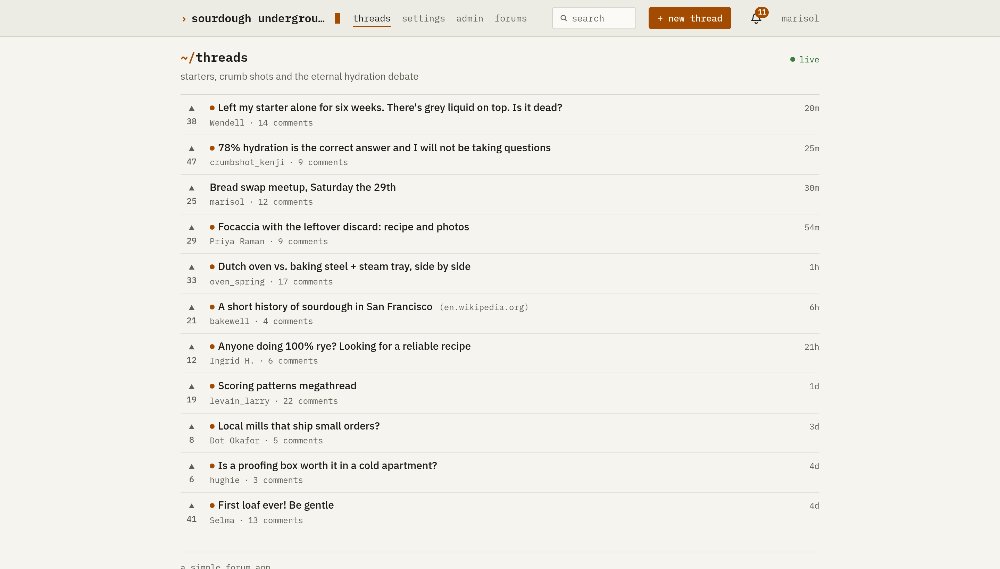
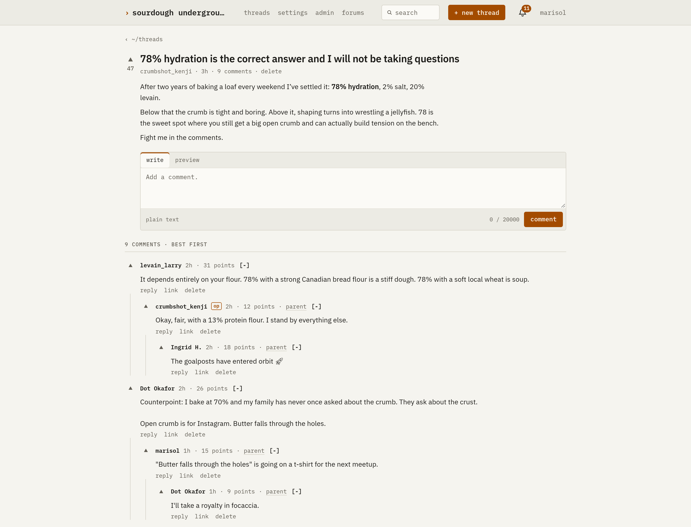
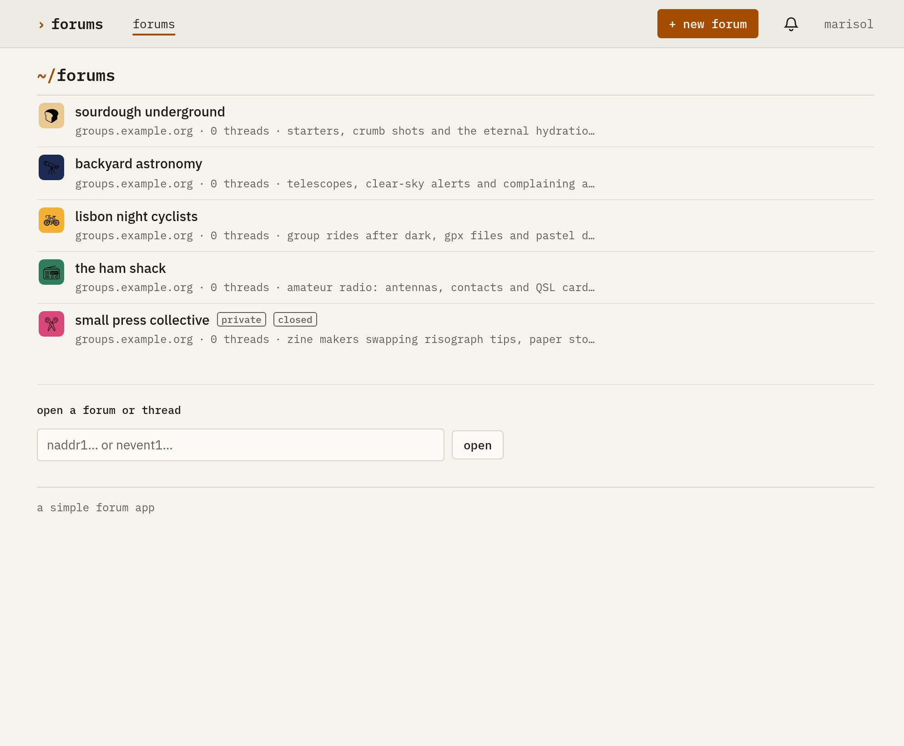
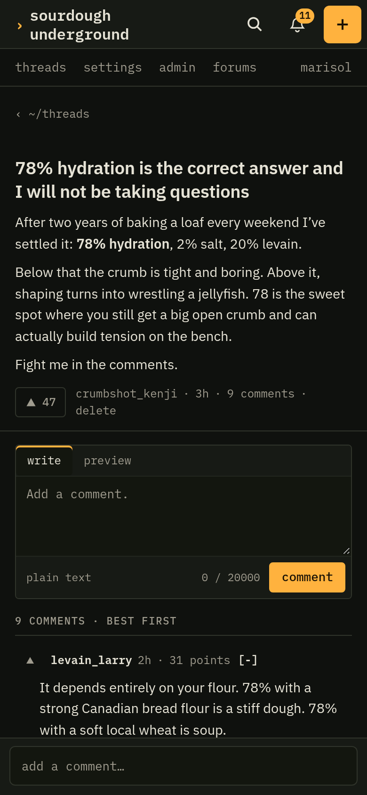
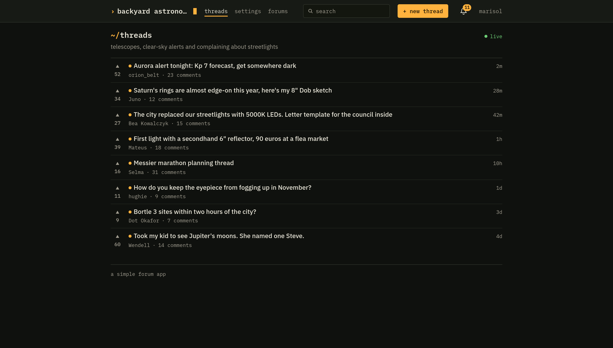

# forum

A simple forum client with the UI copied from
[soliloquy](https://github.com/skorokithakis/soliloquy).

Start a new small forum and invite people in less than a minute.

- Threads with nested comments and upvotes.
- Public or private; open or invite-only.
- Admins can rename, manage members and invites, and delete posts.
- Live threads and comments (no reload).
- Notifications for replies and mentions.
- Search, dark mode, and no annoying sign-up.

## Server

The forum lives on a server, the app only talks to it. You don't have to host a server
(but you can if you want). we default to creating a forum on `chat.wisp.talk`, but any
server that supports [NIP-29](https://github.com/nostr-protocol/nips/blob/master/29.md)
works.

A forum is not tied to its server. You can start a forum on the default server and move
it later to another server, or to one you run yourself, for example, with
[pyramid](https://github.com/fiatjaf/pyramid).

The client is also not tied to a server, so in the same
[client instance](https://forum.fiatjaf.com) you can connect to forums that exist in
two or more different servers.

  
  

## Licence

[AGPL-3.0](LICENSE)
